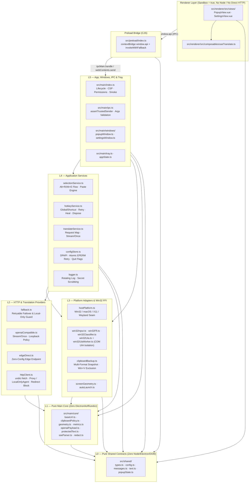
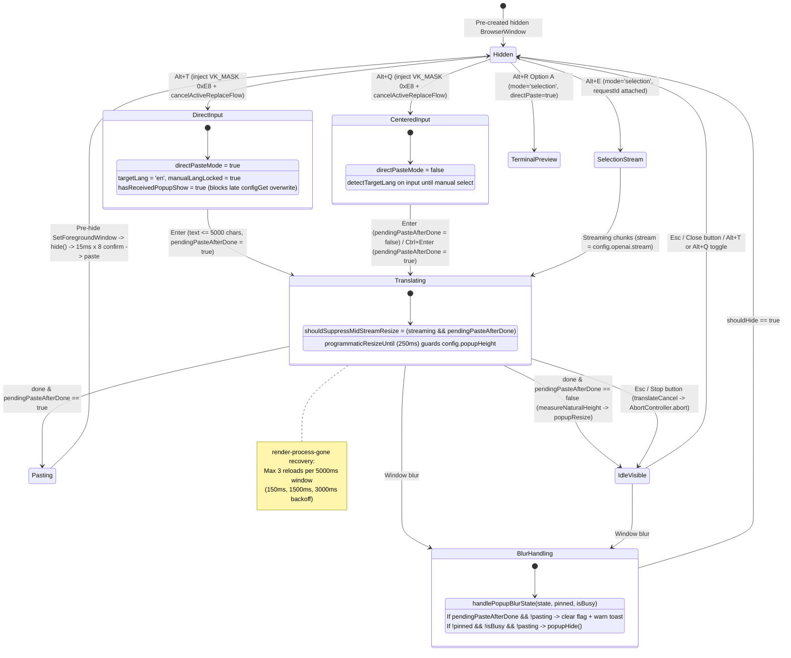
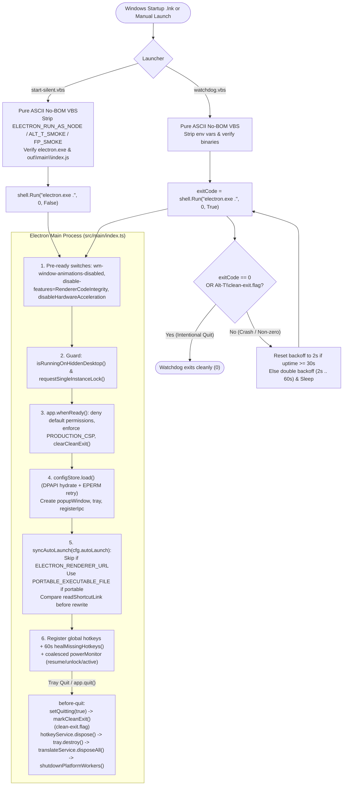

# Architecture Overview — Alt-T

Alt-T is structured around a strict unidirectional layered architecture (`L0`–`L5`, `Preload`, and `Renderer`) enforced automatically by [`scripts/check-rules.mjs`](./scripts/check-rules.mjs). Pure domain logic (`L0` + `L1`) has zero Electron, `koffi`, or `undici` imports so unit and fault-injection tests execute directly in Node.js via `tsx`, while OS integration (`L3`) and services (`L4`) expose dependency-injection seams (`set*ForTest`) for deterministic testing.

---

## 1. Layered Architecture & Dependency Boundaries



### Layer Rules Enforced by `scripts/check-rules.mjs`
- **`core-no-electron`**: `src/shared/**` and `src/main/core/**` cannot import or `require` `electron`, `koffi`, or `undici`.
- **`renderer-no-main` & `renderer-no-http`**: `src/renderer/**` and `src/preload/**` cannot import `src/main/**`; renderer cannot call `fetch()`, `XMLHttpRequest`, or `axios`.
- **`platform-guard`**: Direct `process.platform` and `os.platform()` checks are isolated inside `src/main/platform/**`.
- **`platform-no-service-state`**: `src/main/platform/**` cannot import stateful application services (`configStore`, `selectionService`, `hotkeyService`, `translateService`).
- **`popup-close-guard`**: `popupWindow.ts` `'close'` listener must guard with `isQuitting()` before `preventDefault() + hide()`.

---

## 2. `Alt+R` Selection & Terminal Direct-Paste Flow

This diagram captures the end-to-end execution of `runSelectionFlow('replace')` (`Alt+R`) and `pasteTextToWindow` (`Alt+T` / `Enter`-to-paste) across `selectionService.ts`, `win32Input.ts`, `clipboardBackup.ts`, and `popupWindow.ts`.

```mermaid
sequenceDiagram
    autonumber
    actor User as Developer
    participant HK as hotkeyService
    participant SEL as selectionService
    participant WIN as win32Input / hostPlatform
    participant CLIP as clipboardBackup
    participant TR as translateService (OpenAI / Edge)
    participant POP as popupWindow / PopupView

    User->>HK: Press Alt+R (or Alt+T)
    alt Alt+R Selection Replace
        HK->>SEL: runSelectionFlow('replace')
        Note over SEL: S0: Acquire mutex busy=true + 30s watchdog AbortController
        SEL->>WIN: S1: getActiveTargetHandle()
        WIN-->>SEL: handle0
        SEL->>WIN: isOwnProcessWindow(handle0)?
        alt Own Process Window
            SEL-->>HK: Return 'no-selection'
        else External Window
            SEL->>WIN: isWindowElevatedOverSelf(handle0) [TokenIntegrityLevel=25]
            alt Elevated / UIPI Blocked
                SEL-->>User: Notify "未选中文本或目标窗口为高权限(UIPI)"
            else Same or Lower Integrity
                SEL->>WIN: resolveIdeWindowClassification (win32UiaWorker) + GetWindowTextW (wt)
                Note over WIN: Class-first: CASCADIA -> wt; Console/mintty -> conhost<br/>Code/JetBrains -> UIA worker ('editor'|'terminal'|'unknown')
                alt IDE Region Unknown
                    SEL->>CLIP: restoreClipboard(snap1) if touched
                    SEL->>POP: openDirectInput(handle0) [or prompt manual copy]
                else Capture Allowed
                    SEL->>WIN: S2: releasePressedModifiers()
                    SEL->>CLIP: S3: snap1 = backupClipboard() + writeSentinel() [Win+V excluded]
                    SEL->>WIN: S4: dispatchCopyShortcut(copyKind) [Ctrl+C / Ctrl+Shift+C / Ctrl+Insert]
                    SEL->>CLIP: S5: waitForClipboardChange(25ms, 220ms term / 400ms std)
                    alt Timeout (no selection) & Terminal
                        SEL->>CLIP: restoreClipboard(snap1)
                        SEL->>POP: openDirectInput(handle0) [Fallback to Alt+T]
                    else Text Captured
                        SEL->>CLIP: S7: restoreClipboard(snap1); seqAfterS7 = GetClipboardSequenceNumber()
                        SEL->>TR: S10b: translateOnce({text, to, protectTechnicalText, promptId}, watchdog.signal)
                        TR-->>SEL: translatedText + protectedVerify result (placeholder integrity check)
                        alt !protectedVerify.ok or postPolicy.confirmRequired
                            SEL->>POP: showInactiveAtCursor() + Hold draft for manual confirm
                        else pasteKind != 'normal' & !terminalAutoBackspace (Option A Default)
                            SEL->>POP: showPopupAtCursor(directPaste: true) + translateDone
                            Note over POP: User reviews/edits translation & presses Enter
                            POP->>SEL: IPC popup:paste-to-target
                        else pasteKind != 'normal' & terminalAutoBackspace (Option B)
                            SEL->>WIN: verifyTargetContext + batched VK_BACK (20/batch, 8ms, re-verify each batch)
                        else pasteKind == 'normal' (GUI App)
                            SEL->>WIN: verifyTargetContext (handle/pid/exe/class) (else S11 showInactiveAtCursor)
                        end
                        Note over SEL,CLIP: Pre-Hide / Pre-Send Verify & Sequence-Safe Restore
                        SEL->>WIN: Pre-check identity -> hidePopup() -> SetForegroundWindow(target)
                        SEL->>WIN: Poll 15ms x 8 confirming foreground == target -> verifyTargetContext()
                        alt Foreground & Target Identity Confirmed
                            SEL->>CLIP: Reuse snap1 if seq == seqAfterS7, else backup snap2
                            SEL->>CLIP: writeTransientClipboardText() [OS monitor/history/cloud excluded]
                            SEL->>WIN: dispatchPasteShortcut(pasteKind)
                            SEL->>SEL: Wait 320ms (POST_PASTE_RESTORE_DELAY_MS)
                            SEL->>CLIP: restoreClipboardIfUnchanged(snap, text, seqAfterWrite)
                        else Target Drift / UIPI Blocked
                            SEL->>POP: reshowPopupInactive() or write plain translation (no restore)
                            SEL-->>User: Prompt target change notice or manual Ctrl+V / Shift+Insert
                        end
                    end
                end
            end
        end
    end
```

---

## 3. Popup State Machine & Reentrancy Protection

`src/shared/popupState.ts`, `PopupView.vue`, `popupWindow.ts`, and `hotkeyService.ts` coordinate to prevent async races, focus steals, and window-size pollution.



---

## 4. Watchdog, AutoLaunch & 24/7 Lifecycle

`start-silent.vbs`, `watchdog.vbs`, `autoLaunch.ts`, `configStore.ts`, `hotkeyService.ts`, and `index.ts` guarantee clean startup, crash recovery, and zero-residue shutdowns.



---

## 5. Module Index

| Layer | Path | Primary Responsibility |
| :--- | :--- | :--- |
| **L0** | `src/shared/types.ts` | `AppConfig`, `DEFAULT_CONFIG`, hardened `DEFAULT_PROMPTS`, `IPC_CHANNELS`, 4-state `PopupPasteReply`, `AppOverrideConfig` |
| **L0** | `src/shared/config.ts` | `mergeConfig`, `normalizeExeBasename`, `mergeAppOverrides`, `resolveEffectiveAppPolicy`, `pruneHistoryItems`, hotkeys |
| **L0** | `src/shared/messages.ts` | Centralized Chinese user-facing messages (`MSG`) |
| **L0** | `src/shared/text.ts` | `detectTargetLang`, `countGraphemes` (`Intl.Segmenter`), `countTerminalEraseChars`, `normalizeTerminalCapturedText` |
| **L0** | `src/shared/popupState.ts` | Pure popup UI state transitions, `directPaste` & target drift gates, confirm/stale-edit cleanup, `5000`-char cap |
| **L1** | `src/main/core/*` | `baseUrl.ts` (`isLoopbackBaseUrl` / `isLoopbackIp`), `protectedText.ts`, `metrics.ts`, `clipboardPolicy.ts`, `geometry.ts`, `openaiPayload.ts`, `sseParser.ts`, `redact.ts` |
| **L2** | `src/main/providers/*` | `httpClient.ts` (`undici`, DNS/redirect local-only guard), `openaiCompatible.ts`, `edgeDirect.ts`, `fallback.ts`, `providerTest.ts` |
| **L3** | `src/main/platform/*` | `win32Classifier.ts`, `win32Uia.ts`, `win32UiaWorker.ts`, `win32Ffi.ts`, `win32Input.ts`, `hostPlatform.ts`, `clipboardBackup.ts`, `screenGeometry.ts`, `autoLaunch.ts` |
| **L4** | `src/main/services/*` | `selectionService.ts` (pre-send verify + Option B batches), `hotkeyService.ts`, `translateService.ts`, `configStore.ts`, `logger.ts` |
| **L5** | `src/main/*` | `index.ts`, `ipc.ts`, `tray.ts`, `appState.ts`, `windows/popupWindow.ts`, `windows/settingsWindow.ts` |
| **P / R** | `src/preload/`, `src/renderer/` | `contextBridge` API with fallback, `PopupView.vue`, `SettingsView.vue`, `useTranslate.ts` |
